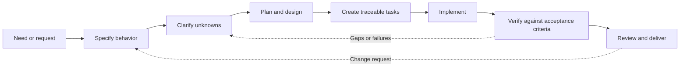
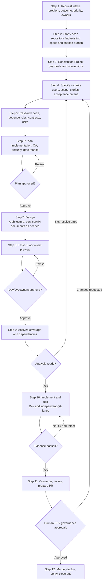
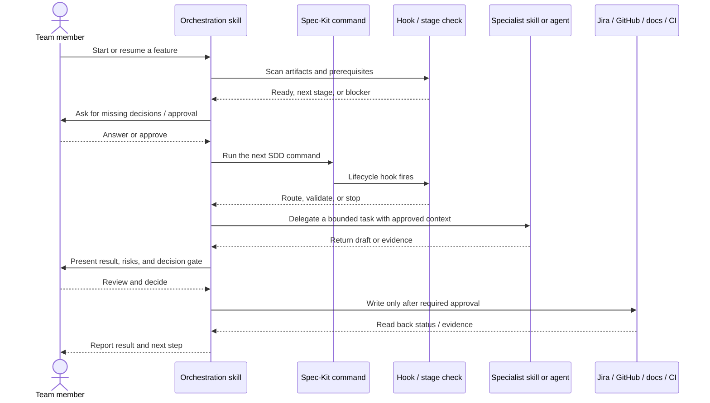

# A Team Guide to Spec-Driven Development with Spec-Kit

This guide describes a reusable way for teams to use Spec-Kit, lifecycle hooks, skills, and specialist agents to streamline software delivery. It focuses on the **process**, not on any particular application or service. A team can adapt the examples, roles, templates, and integrations to its own technology and governance.

## 1. SDD in brief

**Spec-Driven Development (SDD)** is a way of working where the team makes the desired behavior explicit before implementation, then uses that specification to guide design, tasks, tests, and review.

The core idea is simple: agree on **what problem to solve and how success will be recognized** before deciding exactly how to code it. Keep those decisions in reviewable artifacts, and update downstream work when a decision changes.

### Why use SDD?

- **Shared understanding:** business, product, engineering, QA, and architecture can review the same outcomes and constraints.
- **Earlier discovery:** missing acceptance criteria, edge cases, dependencies, and risks are easier to resolve before implementation.
- **Traceability:** requirements can be followed through plans, work items, code, tests, and review evidence.
- **Repeatability:** templates and stage checks reduce variation in routine work.
- **Reliable handoffs:** versioned artifacts let a teammate resume without reconstructing intent from chat history.
- **Safer AI assistance:** agents work from explicit context and bounded tasks; people retain judgment and approval.

### What automation helps with

People provide context, negotiate trade-offs, and make decisions. Automation is particularly useful for repetitive coordination that is easy to miss across a long lifecycle:

- Carrying decisions forward consistently across multiple artifacts.
- Finding existing work and identifying the next incomplete step.
- Checking whether required inputs, task coverage, and approvals are present.
- Preparing separate implementation and QA work.
- Recording evidence and keeping Jira, pull requests, and documents aligned.
- Reopening dependent checks when approved inputs change.

Automation reduces omissions; it does not guarantee correctness. An agent can misunderstand a requirement or produce a faulty change. Human review, independent testing, governance, and release approval remain essential.

## 2. SDD, Spec-Kit, BMAD, and OpenSpec

| Term | Meaning |
| --- | --- |
| **SDD** | A development approach: specify and validate intended behavior before building, and keep delivery traceable to it. |
| **Spec-Kit** | A toolkit for structuring an SDD workflow with conventions, templates, and commands for activities such as constitution, specify, plan, tasks, analyze, and implement. |
| **BMAD** | A separate AI-assisted development framework that organizes work around role-based agents and structured phases. |
| **OpenSpec** | A separate specification-first change workflow/tool that organizes proposed changes and their artifacts. |

**SDD is the approach; Spec-Kit, BMAD, and OpenSpec are different ways to organize or support work.** They have different artifacts, commands, and assumptions. Choose a canonical workflow for each team or change; do not assume their steps or files are interchangeable.

## 3. The lifecycle from intake to delivery

The workflow starts with a business request—called an **FDR** or another intake type in some teams—and finishes with verified delivery and a handoff. Use the team's established meaning and channel for its intake acronym.

### What happens at each stage

| Stage | Main work | Typical outputs |
| --- | --- | --- |
| **1. Intake** | Capture the problem, desired outcome, business priority, source material, stakeholders, and known constraints. | Intake record, links to source material, initial ownership. |
| **2. Start and scan** | Start the workflow, select or create a feature branch, find existing artifacts, and choose the right point to resume. | Branch and feature context, artifact inventory. |
| **3. Constitution** | Record project-wide principles and constraints: technology, quality, security, testing, operations, governance, and team conventions. | Project constitution. |
| **4. Specify and clarify** | Describe actors, behavior, scope, acceptance criteria, data, and non-functional expectations. Ask about ambiguity instead of guessing. | Feature specification and clarified decisions. |
| **5. Research** | Inspect relevant code, tests, dependencies, contracts, documentation, security, operations, and risks. Cite sources and record unresolved questions. | Research notes, decision and risk list. |
| **6. Plan** | Decide an implementation approach, dependencies, verification strategy, QA approach, and governance/security work. | Shared plan and Dev/QA/security/governance plans. |
| **7. Design** | Create or update only the design documents needed for the change. For API work, align the API contract with the approved requirements and conventions. | Architecture/design document, service/API contract, design decision record. |
| **8. Tasks and work items** | Break the plan into small traceable tasks; preview work-item changes before creating or updating them. | Task list, Dev/QA task views, work-item mapping. |
| **9. Analyze** | Check requirement-to-task and acceptance-to-test coverage; find missing, conflicting, or unowned work before implementation. | Analysis findings and coverage matrix. |
| **10. Implement and verify** | Implement approved tasks. Dev produces code, unit tests, and build evidence; QA independently verifies acceptance behavior. Triage security findings. | Code, tests, implementation/QA/security evidence. |
| **11. Converge and review** | Collect evidence, review the change against requirements, address findings, and request approval before commit/push or PR actions. | Review report, proposed PR, readiness evidence. |
| **12. Deliver and close out** | Complete authorized merge and environment steps; verify the deployed change and record handoff/closeout evidence. | CI results, deployment verification, support or closeout record. |

### Human roles

| Role | Contribution |
| --- | --- |
| **Business requester / subject-matter expert** | Explains the problem, business rules, users, constraints, and expected outcome; answers domain questions. |
| **Product Owner (PO)** | Prioritizes work, confirms scope and value, validates stories and acceptance criteria, and accepts the outcome. |
| **Developer / Dev owners** | Researches feasibility, contributes to design, implements approved tasks, writes unit tests, and supplies build evidence. |
| **QA owner / testers** | Challenges testability early, maps acceptance criteria to tests, performs independent verification, and records evidence. |
| **Architect / Tech Lead** | Reviews technical direction, NFRs, design, dependencies, security/governance implications, and readiness gates. |
| **Security / API / governance owner** | Reviews specialist concerns and makes or routes the approvals within their authority. |
| **Release / operations owner** | Confirms environment readiness, follows approved delivery processes, and records operational outcomes. |
| **AI skill / agent** | Drafts or checks a bounded artifact or task, reports results and uncertainties, and waits at human gates. It does not own product decisions or approvals. |

One teammate may hold multiple roles, but ownership and approval authority should be explicit. QA evidence should remain independent of developer unit-test evidence.

## 4. How the automation works

In a Copilot-based setup, the delivery flow is assembled from three cooperating layers:

1. **Spec-Kit commands** perform the core SDD activities and create/update lifecycle artifacts.
2. **A team orchestration skill** guides the user, scans current artifacts, asks for missing inputs, calls Spec-Kit commands, routes specialist tasks, and enforces workflow-specific approval boundaries.
3. **Lifecycle hooks and stage-check scripts** connect Spec-Kit steps to the orchestration skill and validate prerequisites at the points where later work could otherwise proceed on incomplete or stale inputs.

Specialist agents and connected tools are invoked by the skill only when appropriate and available. They return bounded work—such as a draft plan, code change, test report, or review—not authority to approve it.

### Hooks: where the workflow connects

In this workflow, a **Spec-Kit lifecycle hook** is a configured handoff point around a command. It lets the orchestrator check or perform team-specific work before or after that step. A hook does not mean every external action runs unattended.

| Hook / event | What it does in the lifecycle |
| --- | --- |
| `before_plan` | Checks the spec and project context, researches the change, and prepares planning inputs. |
| `after_plan` | Completes plan-related routing, presents the plan approval gate, and proceeds to selected design work. |
| `before_tasks` | Verifies plan/design prerequisites and applicable API/governance approval before tasks are created. |
| `after_tasks` | Previews or prepares Dev/QA task views and work-item synchronization after task generation. |
| `before_taskstoissues` | Stops an unintended issue-creation path and routes work through the approved team process. |
| `after_analyze` | Reviews coverage and findings, records the result, and asks for analysis approval. |
| `before_implement` | Checks approved plans/tasks and starts the appropriate Dev and QA lanes. |
| `after_implement` | Collects implementation, QA, and security evidence and refreshes affected documents. |
| `before_converge` | Blocks convergence if required Dev/QA evidence is missing or unresolved blocking findings remain. |
| `after_converge` | Runs final review/readiness steps and routes the approved change toward PR creation. |
| `change` | Maps a requested artifact change to its owning step, shows downstream impact, and reopens affected checks/approvals. |
| `gov-approved`, `deploy`, `deploy-result` | Record or coordinate governance confirmation, requested non-production deployment, and deployment/QA evidence. These remain explicit user actions. |

Hook names and exact behavior are workflow configuration, not universal Spec-Kit guarantees. When adapting this approach, define what each hook can read/write, what approval it requires, how failures are surfaced, and which checks are blocking.

### Stage checks and evidence

The orchestration skill can call small scripts to scan for existing artifacts, verify worker dependencies, validate required outputs, check approval records, or calculate whether an approved artifact changed. A robust check should **fail visibly** when an input or required approval is absent; it should not create a success-shaped default.

Record enough evidence for a teammate to understand what happened: artifact paths, task IDs, test results, review findings, approvals, and external system read-backs. Avoid storing secrets, customer data, or unnecessary raw scanner payloads.

## 5. Skills and agents used in the workflow

### What is a skill?

A **skill** is a reusable set of instructions, references, and sometimes scripts/templates for a repeatable task. A skill can guide an agent through a process, but it is not itself an agent.

| Skill / command family | Brief purpose |
| --- | --- |
| `example-orchestration-skills` (team orchestration skill) | Start/status/resume/change, discover artifacts, ask questions, route commands and workers, enforce gates, and coordinate delivery. |
| `jira-create-stories-from-epic` | Prepare and synchronize approved work items. |
| API/OpenAPI conventions and API review skills | Draft and check API contracts against requirements and team conventions. |
| Architecture-document and diagram skills | Create or update architecture/service documents and diagrams when selected. |
| Code/PR review and security-remediation skills | Review changes and organize scanner-finding remediation; do not replace required scans or risk acceptance. |

### What is an agent?

An **agent** is a configured AI worker delegated a specialist task with scoped inputs and expected outputs. The team orchestration skill chooses and coordinates agents; a human reviews consequential output.

### Example names used in this guide

The skill and worker names below are generic examples that teams can adapt to their own configuration:

- **`example-orchestration-skills`** is the example team orchestration skill listed in the preceding skills table. It coordinates lifecycle steps, specialist workers, and approval gates.
- **Delivery Pipeline** is the example name for the organization-level agent family, covering code implementation, unit tests, test execution, build verification, and PR creation.
- **Example Project** is a placeholder project name used in **Example Project Delivery Pipeline REST OpenAPI Generator**. Replace it with the receiving team's project name when adapting the workflow.

### Example agents and responsibilities

| Agent / worker in the current workflow configuration | Brief responsibility |
| --- | --- |
| **Delivery Pipeline Code Implementer** | Implements production code from approved requirements and tasks. |
| **Delivery Pipeline Unit Test Implementor** | Creates or updates developer-owned unit tests. |
| **Delivery Pipeline Test Runner** | Runs tests and reports outcomes. |
| **Delivery Pipeline Build Verifier** | Verifies build results. |
| **Test-Assistant** | Supports the independent QA/acceptance-testing lane. |
| **Example Project Delivery Pipeline REST OpenAPI Generator** | Drafts an API contract from the accepted requirements, field inventory, and conventions. |
| **SAD Lifecycle workers** | Author, diagram, and review architecture documents when requested. |
| **Jira Assistant / Jira story sync** | Helps prepare and synchronize approved Jira work items. |
| **Security Remediation Orchestrator** | Organizes remediation options for security findings; a human approves the plan and any risk decision. |
| **GitHub code reviewer / GitHub PR Review** | Reviews code or a pull request against specified criteria and evidence. |
| **API governance reviewer** | Supports API review; authorized people retain governance approval. |
| **Delivery Pipeline PR Creator** | Opens the requested draft PR after commit/push and PR gates are approved. |

These names describe the current subscribed worker configuration and may be replaced with equivalent team-approved workers. A file existing in a repository does not prove the agent is available to invoke: verify its subscription and availability in the current Copilot session before handing work off.

## 6. A practical adoption path for another team

1. **Choose the scope.** Decide which work benefits from a full SDD flow and define a smaller path for low-risk changes, if needed.
2. **Agree on principles.** Create a concise constitution covering quality, security, testing, architecture, documentation, and delivery expectations.
3. **Define artifact templates.** Start with spec, plan, task, analysis, and evidence templates. Add domain documents only when relevant.
4. **Map lifecycle steps to tools.** Choose the team's issue tracker, source control, documentation, CI, security scanners, and deployment process.
5. **Add an orchestration skill.** Teach it where artifacts live, how to resume/change work, what questions to ask, what workers can do, and when to stop.
6. **Wire hooks to checks.** Add lifecycle hooks only where they improve traceability or prevent unsafe progression. Make hook inputs, outputs, and failure behavior explicit.
7. **Assign agents by bounded responsibility.** For each worker, define inputs, outputs, allowed tools, and human review points. Keep Dev and QA evidence distinct.
8. **Make external writes approval-gated.** Preview changes to shared systems and read them back after an approved write.
9. **Pilot with a representative change.** Run dry/local mode first, compare generated artifacts to team expectations, and refine prompts/checks.
10. **Measure and improve.** Track rework, escaped ambiguity, time waiting for decisions, task traceability, test evidence, and handoff quality—not just the number of generated files.

### Safe operating habits

- Ask a person when a business, security, architecture, or product decision is unknown; do not let an agent invent it.
- Keep specs and plans versioned with the work and link evidence to specific artifacts or commits.
- Rerun downstream analysis and approvals when their inputs materially change.
- Treat dry runs as local rehearsals, not proof that external systems or release steps succeeded.
- Preserve independent QA and required security/governance review.
- Require explicit approval before shared-system writes, commits, pushes, PRs, merges, or deployments.
- Report blockers and failed checks plainly; never claim a stage passed without evidence.

Use the workflow definition, synced skill instructions, and team governance as the operational source of truth. Adapt examples to the receiving team's application, tools, and approval policies.
